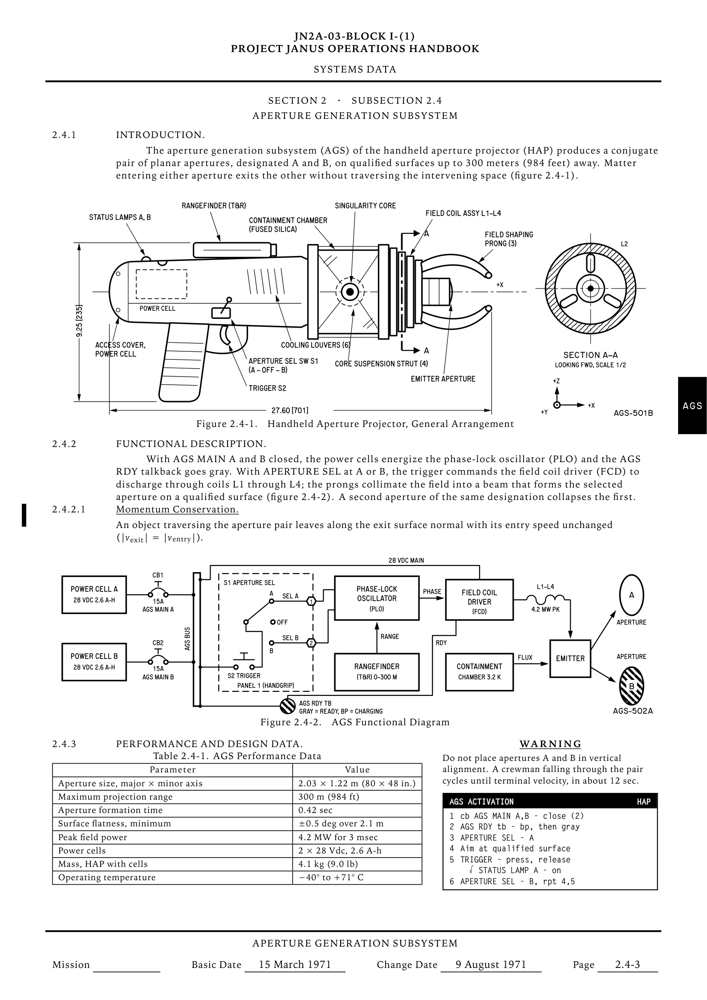

# nasa-handbook

A Claude skill that makes printable technical documents in the style of 1960s
NASA paperwork. It works in two modes:

- **Page mode** makes a single page modelled on a 1969 Apollo Operations
  Handbook "Systems Data" page. The page has a typed running head, numbered
  paragraphs, Leroy-lettered line drawings, a data table, a WARNING and a crew
  checklist card.
- **Handbook mode** makes a document of any length in the same style. It has a
  cover, a record of revisions, contents and lists, numbered sections,
  UML-style system diagrams, requirements, decision records and appendices.
  The structure follows the NASA Systems Engineering Handbook, and the writing
  rules follow the KSC documentation style guide.

Both modes are typeset with XeLaTeX, and the figures are drawn with TikZ.



Inspired by the original
[nasa-handbook skill by R44VC0RP](https://github.com/R44VC0RP/skills/tree/main/skills/nasa-handbook).

## Install

This repository is the skill folder. Clone it into your skills directory
under the name `nasa-handbook`:

```sh
git clone https://github.com/happosade/nasa-handbook.git ~/.claude/skills/nasa-handbook
```

Then start a new session and ask Claude for "a NASA handbook page about …",
or for "a NASA-style handbook documenting …" for a long document. The skill
also triggers on requests for Apollo-style or retro aerospace documentation,
and for vintage spec sheets.

### Instructions for agents installing this skill

1. **Check the requirements** (next section). Each of these must succeed:
   ```sh
   xelatex --version
   kpsewhich fontspec.sty tikz.sty tabularx.sty geometry.sty xfp.sty
   uv --version
   ```
   If `xelatex` is missing, stop and tell the user to install TeX Live or
   MacTeX. Don't install it yourself.
2. **Pick the skills directory.** Claude Code uses `~/.claude/skills/` for
   the user, or `.claude/skills/` for one project. For another agent, use the
   folder it loads `SKILL.md` skills from.
3. **Move an existing copy out of the way.** If `<skills dir>/nasa-handbook`
   exists, move it outside the skills directory (for example to
   `~/.claude/nasa-handbook.bak`). Don't copy the new version over it,
   because the old files would stay mixed in with the new ones. Don't keep the
   backup inside the skills directory either, or it loads as a second skill.
4. **Install:**
   `git clone https://github.com/happosade/nasa-handbook.git <skills dir>/nasa-handbook`,
   or copy this folder there.
5. **Verify** by rendering an example in a scratch folder:
   ```sh
   T=$(mktemp -d) && cp <skills dir>/nasa-handbook/assets/examples/portal-gun-device.tex <skills dir>/nasa-handbook/assets/nasa-handbook.cls "$T/" && cp -R <skills dir>/nasa-handbook/assets/fonts "$T/fonts"
   sh <skills dir>/nasa-handbook/scripts/render.sh "$T/portal-gun-device.tex"
   ```
   It should print a `pdf:` line and `fit: … mm free above the footer`, and
   exit 0.
6. **Tell the user** to start a new session, because skills are loaded
   when a session starts.

In a sandbox (such as nono), XeLaTeX needs no extra permissions beyond
reading the TeX install and writing the page folder. LuaLaTeX is not used.

## Requirements

- XeLaTeX from TeX Live 2021 or later (MacTeX on macOS). The skill uses
  `fontspec`, TikZ 3.1.6 or later, `tabularx` and `geometry`, all of which
  are in a full install.
- `uv` (or a Python with `pymupdf`), for the page check and the PNG preview.

LuaLaTeX and Chrome are not used. Fonts load from the bundled `assets/fonts/`
folder. Iowan Old Style comes from macOS; elsewhere the body text falls back
to TeX Gyre Pagella, which ships with TeX Live.

## Using it without Claude

### A single page

Copy `assets/template.tex`, `assets/nasa-handbook.cls` and `assets/fonts/`
into a folder, fill in the template, then render and check the page:

```sh
sh scripts/render.sh path/to/page.tex
uv run --no-project --with pymupdf python scripts/check.py path/to/page.pdf
```

`render.sh` reports how much room is left above the footer. It exits with
code 3 when the content overflows onto a second page.

`check.py` confirms the PDF has one page and is black and white only, and
lists the fonts it uses. It also writes `page.png` next to the PDF.

### A handbook

Copy `assets/handbook-template.tex` instead of `template.tex`; the class and
fonts are the same. The template starts with
`\documentclass[handbook]{nasa-handbook}` (add `letter` for US Letter) and
uses these commands:

| Command | What it makes |
|---|---|
| `\nhcover` | Title page with doc number, title, part, issuer and date |
| `nhhistory` / `\nhhist` | Record of Revisions/Changes |
| `\nhcontents` | Table of Contents, and Lists of Figures, Tables and Boxes |
| `\nhchapter[TAB]{TITLE}` | A numbered section on a new page, with its own thumb tab and `3-1`, `3-2` page numbers. The starred form is unnumbered (Preface) |
| `\nhappendix` | Switches later sections to lettered appendices |
| `nhgrid` | A table with any columns: requirements, trade matrices, acronyms |
| `nhbox` | A titled sidebar box |
| `nhdecision` / `\nhfield` | A decision record (ADR): status, context, options, decision, rationale, consequences |

`nhpara`, `nhfigure`, `nhtable`, `\nhnotice` and `nhchecklist` work as in
page mode and can go anywhere in the text.

Render and check with any page count allowed:

```sh
sh scripts/render.sh path/to/handbook.tex
uv run --no-project --with pymupdf python scripts/check.py path/to/handbook.pdf --pages 0
```

In handbook mode `render.sh` runs XeLaTeX twice so the contents fill in, and
it prints `fit: handbook, N pages` instead of a fit check.

### References

`references/style-guide.md` explains the page anatomy and the writing voice.
Its §10 covers handbook structure, the KSC-DF-107 writing rules and decision
records. `references/tikz-parts.md` has copy-paste drawing parts, including
UML-style component, sequence, state and process-flow diagrams.
`references/sources.md` lists the NASA documents behind each choice.

## Rebuilding the examples

```sh
cd assets/examples && cp ../nasa-handbook.cls . && cp -R ../fonts .
sh ../../scripts/render.sh portal-gun-device.tex
```

## Credits and licences

The idea comes from the
[nasa-handbook skill by R44VC0RP](https://github.com/R44VC0RP/skills/tree/main/skills/nasa-handbook).

Routed Gothic is under SIL OFL 1.1. Letter Gothic Code is under the Aladdin
Free Public License. Both licence texts are in `assets/fonts/`.
